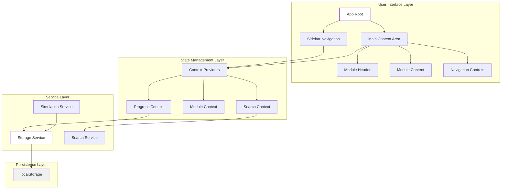
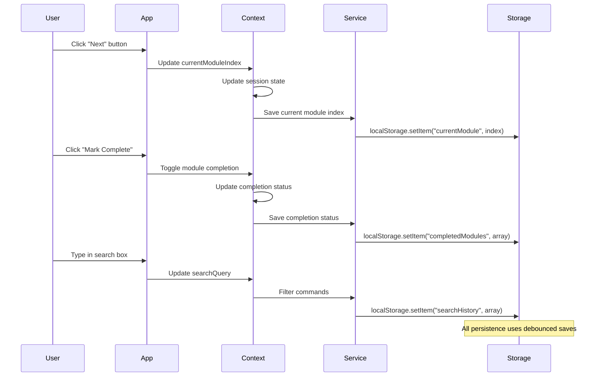

# Technical Design Document: Kiro Crash Course Educational Website

## Overview

The Kiro Crash Course is an interactive educational frontend built with React, TypeScript, Vite, Tailwind CSS, Lucide Icons, and Framer Motion. This document outlines the technical architecture and implementation strategy for delivering a professional, beginner-friendly learning experience that introduces Kiro's agentic development ecosystem.

### Design Goals

- **Beginner-Friendly**: Clear progression, minimal jargon, interactive examples
- **Interactive Learning**: Simulated CLI, interactive diagrams, visual feedback
- **Persistent Progress**: Automatic saving of completion status and current position
- **Responsive Design**: Works across desktop, tablet, and mobile devices
- **Performance**: Fast load times, smooth animations, efficient re-renders

### Technical Stack Summary

| Category | Technology | Version | Purpose |
|----------|-----------|---------|---------|
| Framework | React | 18+ | UI component library |
| Type System | TypeScript | 5+ | Type-safe development |
| Build Tool | Vite | 5+ | Development and build |
| Styling | Tailwind CSS | 3+ | Utility-first CSS framework |
| Icons | Lucide React | Latest | Consistent iconography |
| Animations | Framer Motion | Latest | Smooth transitions |
| Code Highlighting | Prism.js | Latest | Syntax highlighting |
| Diagrams | Mermaid.js | Latest | Architecture visualization |
| State Management | React Context + Hooks | 18+ | Local state management |
| Storage | localStorage | Native | Persistent data storage |

---

## Architecture

### High-Level Architecture Diagram



### Component Hierarchy

```
App (root)
├── Sidebar
│   ├── ModuleList
│   ├── ProgressBar (circular indicator)
│   └── NavigationButtons (top-level)
├── MainContent
│   ├── ModuleHeader
│   │   ├── ModuleTitle
│   │   ├── CompletionBadge
│   │   └── ProgressIndicator
│   ├── ModuleContent
│   │   ├── Section: WhatItIs
│   │   ├── Section: WhyItMatters
│   │   ├── Section: HowItWorks
│   │   ├── Section: Example
│   │   └── Section: KeyTakeaway
│   ├── InteractiveElements
│   │   ├── MermaidDiagram (conditional)
│   │   ├── CodeBlock (with copy functionality)
│   │   ├── CLITerminal (conditional)
│   │   └── EcosystemVisualization (conditional)
│   └── NavigationControls
│       ├── PreviousButton
│       └── NextButton
└── Footer
    └── QuickReference (search and command list)
```

### State Flow Diagram



### Responsive Design Breakpoints

| Breakpoint | Width | Layout Changes |
|------------|-------|----------------|
| Desktop | > 1024px | Full sidebar, content max-width 1200px |
| Tablet | 768-1024px | Abbreviated sidebar labels, condensed spacing |
| Mobile | < 768px | Hamburger menu, icon-only sidebar, stacked modules |

---

## Components and Interfaces

### Data Models (TypeScript)

```typescript
// Module data structure
interface Module {
  id: string;
  title: string;
  description: string;
  completed: boolean;
  content: ModuleContent;
  order: number;
  prerequisites?: string[];
  relatedModules?: string[];
}

interface ModuleContent {
  whatItIs: string;
  whyItMatters: string;
  howItWorks: string;
  example?: ModuleExample;
  keyTakeaway: string;
  hasDiagram?: boolean;
  hasCodeExample?: boolean;
  hasCliDemo?: boolean;
  hasEcosystemDemo?: boolean;
}

interface ModuleExample {
  title: string;
  description: string;
  code: string;
  language: 'typescript' | 'json' | 'bash' | 'markdown';
}

// CLI Command structure
interface CLICommand {
  command: string;
  description: string;
  examples: string[];
  category: 'general' | 'auth' | 'chat' | 'project' | 'help';
}

// Search result structure
interface SearchResult {
  command: CLICommand;
  module: string;
  score: number; // relevance score
}

// Progress tracking structure
interface ProgressState {
  currentModuleIndex: number;
  completedModules: string[]; // array of module IDs
  searchHistory: string[]; // recent search queries
  lastViewedModule: number | null;
}

// Animation variants
const sidebarVariants = {
  desktop: { width: '280px' },
  tablet: { width: '200px' },
  mobile: { width: '60px' },
  collapsed: { width: '60px' },
};

const animationConfig = {
  duration: 0.3,
  ease: 'easeInOut',
};
```

### Component Specifications

#### 1. Sidebar Component

**Props:**
```typescript
interface SidebarProps {
  modules: Module[];
  currentModuleIndex: number;
  collapsed: boolean;
  onModuleSelect: (index: number) => void;
  onToggleCollapse: () => void;
  progress: ProgressState;
}
```

**Features:**
- Scrollable module list with icons
- Current module highlight (purple accent: `#8A2BE2`)
- Progress indicators (circular overlays)
- Completion checkmarks for completed modules
- Responsive collapse behavior (< 768px)

**Styling:**
- Background: `bg-white`
- Text: `text-gray-900`
- Accent: `text-purple-600` (#8A2BE2)
- Secondary: `text-purple-200` (#D8B4FE)
- Border radius: `rounded-lg` (4px)
- Hover: `hover:bg-purple-50`

#### 2. ModuleHeader Component

**Props:**
```typescript
interface ModuleHeaderProps {
  module: Module;
  currentModuleIndex: number;
  totalModules: number;
  progressPercentage: number;
  onMarkComplete: (moduleId: string) => void;
}
```

**Features:**
- Module title and progress counter (e.g., "Module 1 of 10")
- Completion badge vs. "Mark Complete" button
- Circular progress indicator
- Visual feedback for completion state

#### 3. ModuleContent Component

**Props:**
```typescript
interface ModuleContentProps {
  content: ModuleContent;
  moduleId: string;
}
```

**Features:**
- Sequential sections: What → Why → How → Example → Key Takeaway
- Interactive Mermaid diagram rendering
- Syntax-highlighted code blocks with copy functionality
- Responsive section spacing (24px vertical spacing)

#### 4. NavigationControls Component

**Props:**
```typescript
interface NavigationControlsProps {
  currentModuleIndex: number;
  totalModules: number;
  onPrevious: () => void;
  onNext: () => void;
}
```

**Features:**
- Previous/Next buttons with slide animations
- Disabled state for first/last modules
- Animation variants for direction
- Keyboard navigation support

#### 5. CLITerminal Component (Simulated Playground)

**Props:**
```typescript
interface CLITerminalProps {
  commands: CLICommand[];
  onCommandSubmit: (command: string) => void;
}
```

**Features:**
- Command history display
- Predefined command responses
- Simulated typing animation
- Syntax highlighting for commands

**Supported Commands:**
- `kiro-cli --help` - Command options with descriptions
- `kiro-cli login` - Authentication flow simulation
- `kiro-cli chat` - Chat mode simulation
- `kiro-cli --version` - Version string
- Unknown commands - Blank/no-op response

#### 6. QuickReference Component

**Props:**
```typescript
interface QuickReferenceProps {
  allCommands: CLICommand[];
  searchHistory: string[];
  onSearch: (query: string) => void;
  onClearHistory: () => void;
}
```

**Features:**
- Real-time search filtering
- Recent search history
- No-results message
- Search query persistence

---

## Data Models

### Module Data Structure

Each module follows a consistent structure with standardized sections:

```typescript
{
  id: "module-1",
  title: "Introduction to Kiro",
  description: "Learn about Kiro's agentic development ecosystem",
  completed: false,
  order: 1,
  prerequisites: [],
  relatedModules: ["module-2"],
  content: {
    whatItIs: "Kiro is an agentic AI software engineer...",
    whyItMatters: "Agentic development changes how we build software...",
    howItWorks: "Kiro operates through MCP servers and custom agents...",
    example: {
      title: "Basic Kiro Command",
      description: "See Kiro in action with a simple command",
      code: "kiro-cli chat\n> create a TODO list app",
      language: "bash"
    },
    keyTakeaway: "Kiro transforms development through autonomous agents."
  }
}
```

### 10 Course Modules

| Module | Title | Key Topics | Interactive Elements |
|--------|-------|------------|---------------------|
| 1 | Introduction to Kiro | What is Kiro, agentic development, setup | CLITerminal |
| 2 | Kiro IDE | VS Code integration, context, session types | EcosystemVisualization |
| 3 | Specs | Requirements → Design → Tasks workflow | MermaidDiagram |
| 4 | Steering | Project guidelines, configuration | CLITerminal |
| 5 | Agentic Hooks | Event-driven automation | MermaidDiagram |
| 6 | MCP | Model Context Protocol, servers, capabilities | EcosystemVisualization |
| 7 | Custom Agents | Building specialized agents | CLITerminal |
| 8 | Kiro Powers | Curated packages, workflow guides | MermaidDiagram |
| 9 | Kiro Crew | Multi-agent collaboration | EcosystemVisualization |
| 10 | Kiro CLI | Command reference, common patterns | CLITerminal |

---

## State Management

### Context Providers

The application uses React Context for state management with three main contexts:

#### 1. ProgressContext

Manages module completion and navigation state:

```typescript
const [currentModuleIndex, setCurrentModuleIndex] = useState(
  () => parseInt(localStorage.getItem('currentModule') || '0')
);

const [completedModules, setCompletedModules] = useState(
  () => JSON.parse(localStorage.getItem('completedModules') || '[]')
);

// Computed values
const progressPercentage = useMemo(() => {
  return Math.round((completedModules.length / modules.length) * 100);
}, [completedModules, modules.length]);

// Actions
const toggleModuleComplete = useCallback((moduleId: string) => {
  // Save only completion status, percentage is recomputed on load
}, []);
```

#### 2. ModuleContext

Manages the current module data and content:

```typescript
const [currentModule, setCurrentModule] = useState<Module | null>(null);

useEffect(() => {
  const module = modules[currentModuleIndex];
  setCurrentModule(module);
}, [currentModuleIndex, modules]);
```

#### 3. SearchContext

Manages quick reference search state:

```typescript
const [searchQuery, setSearchQuery] = useState('');
const [searchResults, setSearchResults] = useState<SearchResult[]>([]);
const [searchHistory, setSearchHistory] = useState(
  () => JSON.parse(localStorage.getItem('searchHistory') || '[]')
);
```

### State Persistence Strategy

| Data | Storage Method | Persistence Duration |
|------|---------------|---------------------|
| Current module index | localStorage | Session + reload |
| Completed modules | localStorage | Persistent |
| Search history | localStorage | Persistent |
| Last viewed module | localStorage | Persistent |

**Debouncing:** All save operations are debounced by 300ms to prevent excessive localStorage writes.

---

## Correctness Properties

*A property is a characteristic or behavior that should hold true across all valid executions of a system—essentially, a formal statement about what the system should do. Properties serve as the bridge between human-readable specifications and machine-verifiable correctness guarantees.*

### Property 1: Sidebar highlights current module

*For any* valid module index and array of modules, the sidebar shall highlight exactly the module at the current index with the purple accent color and display a checkmark for all completed modules.

**Validates: Requirements 1**

### Property 2: Module completion calculation

*For any* set of module completion states, the overall completion percentage shall equal (completed_modules_count / total_modules_count) * 100, rounded to the nearest integer.

**Validates: Requirements 3**

### Property 3: Progress persistence round trip

*For any* module completion state and current module index, saving the state to localStorage and then reloading the page shall restore the exact same state.

**Validates: Requirements 3**

### Property 4: Search query filtering

*For any* search query and array of commands, the filtered results shall include only commands where the query string matches (case-insensitive) the command syntax, description, or category, and all results shall include the required display information (syntax, description, module reference).

**Validates: Requirements 7**

### Property 5: CLI command response generation

*For any* command input, the simulation engine shall return a predefined response for recognized commands (kiro-cli --help, login, chat, --version) and a blank/no-op response for unrecognized commands.

**Validates: Requirements 6**

### Property 6: Navigation button availability

*For any* current module index and total module count, the Previous button shall be disabled if and only if currentModuleIndex === 0, and the Next button shall be disabled if and only if currentModuleIndex === totalModules - 1.

**Validates: Requirements 8**

### Property 7: Color scheme consistency

*For any* page in the application, all backgrounds shall use white (#FFFFFF), all primary accents shall use purple (#8A2BE2), and all secondary accents shall use light purple (#D8B4FE), with a consistent 4px border radius on all cards and interactive elements.

**Validates: Requirements 10**

---

## Error Handling

### Error Boundaries

```typescript
// Module-specific error boundary for Mermaid diagrams
class DiagramErrorBoundary extends React.Component {
  state = { hasError: false };
  
  static getDerivedStateFromError() {
    return { hasError: true };
  }
  
  render() {
    if (this.state.hasError) {
      return <div className="text-red-500">Failed to render diagram</div>;
    }
    return this.props.children;
  }
}
```

### Network and Storage Errors

- **localStorage quota exceeded**: Gracefully degrade by reducing persistence scope
- **Mermaid rendering failure**: Display fallback message with manual workaround
- **Code highlighting error**: Show raw code with language indicator

### Validation and User Feedback

| Error Type | Handling Strategy | User Feedback |
|------------|------------------|---------------|
| Invalid command | No-op response, no crash | Console warning only |
| Invalid localStorage data | Reset to defaults | Silent recovery |
| Mermaid parse error | Display error message | Inline notification |
| Search empty state | Show no-results message | "No commands found" |

---

## Testing Strategy

### Dual Testing Approach

This project uses a combination of unit tests and property-based tests for comprehensive coverage:

- **Unit tests**: Verify specific examples, edge cases, and integration points
- **Property tests**: Verify universal properties across all inputs (when applicable)

### Property-Based Testing Configuration

For properties identified as testable, we use **fast-check** (for TypeScript) with the following configuration:

- **Minimum iterations**: 100 per property test
- **Test tag format**: `Feature: kiro-crash-course, Property {number}: {property_text}`
- **Timeout**: 2 seconds per test run

### Property-Based Test Examples

#### Property 1 Test: Sidebar highlights current module

```typescript
import * as fc from 'fast-check';
import { render, screen } from '@testing-library/react';
import Sidebar from './Sidebar';

describe('Sidebar Property 1', () => {
  it('Feature: kiro-crash-course, Property 1: Sidebar highlights current module', () => {
    fc.assert(
      fc.property(
        fc.array(fc.string({ minLength: 1 }), { minLength: 1 }),
        fc.integer({ min: 0, max: 9 }),
        (moduleTitles, currentIndex) => {
          // Generate modules with random completion states
          const modules = moduleTitles.map((title, i) => ({
            id: `module-${i}`,
            title,
            completed: Math.random() > 0.5,
            content: {} as any,
            order: i,
          }));
          
          render(<Sidebar modules={modules} currentModuleIndex={currentIndex} />);
          
          // Verify the current module is highlighted
          const currentModuleElement = screen.getByText(modules[currentIndex].title);
          expect(currentModuleElement).toHaveClass('text-purple-600');
          
          // Verify completed modules have checkmarks
          const completedModules = modules.filter(m => m.completed);
          completedModules.forEach(module => {
            expect(screen.getByText(module.title)).toHaveClass('checkmark-visible');
          });
        }
      ),
      { numRuns: 100 }
    );
  });
});
```

#### Property 2 Test: Module completion calculation

```typescript
it('Feature: kiro-crash-course, Property 2: Module completion calculation', () => {
  fc.assert(
    fc.property(
      fc.array(
        fc.tuple(
          fc.string({ minLength: 1 }),
          fc.boolean()
        ),
        { minLength: 1 }
      ),
      (moduleEntries) => {
        const modules = moduleEntries.map(([title, completed], i) => ({
          id: `module-${i}`,
          title,
          completed,
          content: {} as any,
          order: i,
        }));
        
        const completedCount = modules.filter(m => m.completed).length;
        const expectedPercentage = Math.round((completedCount / modules.length) * 100);
        
        expect(computeProgressPercentage(modules)).toBe(expectedPercentage);
      }
    ),
    { numRuns: 100 }
  );
});
```

### Unit Test Examples

#### Example 1: CLITerminal command handling

```typescript
describe('CLITerminal Command Handling', () => {
  it('handles kiro-cli --help command', () => {
    const { getByText } = render(<CLITerminal commands={[]} />);
    const terminal = getByTestId('cli-terminal');
    
    // Simulate command input
    fireEvent.change(terminal, { target: { value: 'kiro-cli --help' } });
    fireEvent.submit(terminal);
    
    expect(terminal).toHaveTextContent(/kiro-cli.*options/i);
  });
  
  it('handles unknown command with no-op response', () => {
    const { getByTestId } = render(<CLITerminal commands={[]} />);
    const terminal = getByTestId('cli-terminal');
    
    fireEvent.change(terminal, { target: { value: 'unknown-command' } });
    fireEvent.submit(terminal);
    
    // Should show blank/no-op response
    expect(terminal).not.toHaveTextContent(/error/i);
  });
});
```

### Integration Test Examples

#### Example 1: Module navigation flow

```typescript
describe('Module Navigation Integration', () => {
  it('navigates through all modules sequentially', () => {
    render(<App />);
    
    // Start at module 0
    expect(screen.getByText('Module 1 of 10')).toBeInTheDocument();
    
    // Click next 9 times to reach module 10
    const nextButton = screen.getByText('Next');
    for (let i = 0; i < 9; i++) {
      fireEvent.click(nextButton);
    }
    
    expect(screen.getByText('Module 10 of 10')).toBeInTheDocument();
    expect(nextButton).toBeDisabled();
    
    // Cannot go back before module 1
    const prevButton = screen.getByText('Previous');
    expect(prevButton).toBeDisabled();
  });
});
```

### Testing Matrix

| Testing Type | Properties Covered | Examples Covered | Edge Cases |
|--------------|-------------------|------------------|------------|
| Property-based | All universal properties | N/A | All input variations |
| Unit tests | N/A | Specific behaviors | Error conditions |
| Integration | End-to-end flows | User journeys | Navigation sequences |
| Snapshot tests | UI consistency | Component renders | Responsive states |

### Test Coverage Targets

- **Property-based tests**: 7 core properties (100 iterations each)
- **Unit tests**: ~15 specific examples and edge cases
- **Integration tests**: 5 key user journeys
- **Snapshot tests**: 20 component renders (responsive states)

---

## Animation Specifications (Framer Motion)

### Sidebar Animation

```typescript
const sidebarAnimations = {
  desktop: {
    width: '280px',
    transition: { duration: 0.3, ease: 'easeInOut' }
  },
  tablet: {
    width: '200px',
    transition: { duration: 0.3, ease: 'easeInOut' }
  },
  mobile: {
    width: '60px',
    transition: { duration: 0.3, ease: 'easeInOut' }
  }
};

// Mobile hamburger menu
const menuAnimation = {
  initial: { opacity: 0, x: -20 },
  animate: { opacity: 1, x: 0 },
  exit: { opacity: 0, x: -20 }
};
```

### Module Transition Animation

```typescript
const moduleSlideAnimation = {
  initial: { opacity: 0, x: 50 },
  animate: { opacity: 1, x: 0 },
  exit: { opacity: 0, x: -50 },
  transition: { duration: 0.3, ease: 'easeInOut' }
};

// Direction-based animations
const slideLeft = {
  initial: { opacity: 0, x: 50 },
  animate: { opacity: 1, x: 0 },
  exit: { opacity: 0, x: -50 }
};

const slideRight = {
  initial: { opacity: 0, x: -50 },
  animate: { opacity: 1, x: 0 },
  exit: { opacity: 0, x: 50 }
};
```

### Code Block Copy Animation

```typescript
const copyButtonAnimation = {
  initial: { scale: 1 },
  animate: { 
    scale: [1, 1.2, 1],
    transition: { duration: 0.5 }
  }
};

const confirmationMessage = {
  initial: { opacity: 0, y: 10 },
  animate: { opacity: 1, y: 0 },
  exit: { opacity: 0, y: -10 },
  transition: { duration: 0.3 }
};
```

### Progress Indicator Animation

```typescript
const circularProgress = {
  initial: { pathLength: 0 },
  animate: { pathLength: 1 },
  transition: { duration: 0.5, ease: 'easeOut' }
};
```

---

## Performance Considerations

### Optimization Strategies

1. **Code Splitting**: Lazy load module content and heavy components (Mermaid, EcosystemVisualization)
2. **Memoization**: Use `useMemo` and `useCallback` for expensive computations
3. **Debounced Saves**: 300ms debounce for localStorage operations
4. **Virtual Scrolling**: Consider for large module lists (> 20 items)
5. **Image Optimization**: Use WebP format for any static images

### Bundle Size Targets

| Bundle | Target Size | Strategy |
|--------|-------------|----------|
| Main JS | < 150KB (gzipped) | Code splitting |
| CSS | < 50KB (gzipped) | Tree-shaking |
| Images | < 100KB total | WebP optimization |

### Load Performance Goals

- **First Contentful Paint (FCP)**: < 1s
- **Time to Interactive (TTI)**: < 3s
- **Largest Contentful Paint (LCP)**: < 2.5s

---

## Accessibility

### Keyboard Navigation

- **Sidebar**: Arrow keys for module selection, Enter to activate
- **Navigation Controls**: Tab navigation with proper focus order
- **Search**: Enter to search, Escape to clear

### ARIA Labels

```typescript
// Progress indicator
<span aria-label={`Progress: ${progressPercentage}% completed`}>
  {/* circular progress SVG */}
</span>

// Module completion
<span aria-label={`Module ${module.title} is ${module.completed ? 'completed' : 'incomplete'}`}>
  {/* checkmark or placeholder */}
</span>
```

### Color Contrast

- Primary purple (#8A2BE2) on white: 4.5:1 ratio (AA compliant)
- Secondary purple (#D8B4FE) on white: 1.8:1 ratio (decorative only)
- Text on white: 21:1 ratio (AAA compliant)

### Focus Management

- Skip-to-content link on page load
- Focus trap in modals (if any)
- Focus ring on interactive elements

---

## File Structure

```
src/
├── components/
│   ├── layout/
│   │   ├── App.tsx
│   │   ├── Sidebar.tsx
│   │   ├── MainContent.tsx
│   │   └── Footer.tsx
│   ├── modules/
│   │   ├── ModuleHeader.tsx
│   │   ├── ModuleContent.tsx
│   │   ├── ModuleSection.tsx
│   │   └── InteractiveElements.tsx
│   ├── navigation/
│   │   ├── NavigationControls.tsx
│   │   ├── PreviousButton.tsx
│   │   └── NextButton.tsx
│   └── interactive/
│       ├── MermaidDiagram.tsx
│       ├── CodeBlock.tsx
│       ├── CLITerminal.tsx
│       ├── EcosystemVisualization.tsx
│       └── QuickReference.tsx
├── contexts/
│   ├── ProgressContext.tsx
│   ├── ModuleContext.tsx
│   └── SearchContext.tsx
├── services/
│   ├── storageService.ts
│   ├── simulationService.ts
│   └── searchService.ts
├── hooks/
│   ├── useProgress.ts
│   ├── useModuleNavigation.ts
│   └── useSearch.ts
├── types/
│   └── index.ts
├── constants/
│   ├── modules.ts
│   ├── cliCommands.ts
│   └── animations.ts
├── utils/
│   ├── animationUtils.ts
│   └── storageUtils.ts
├── styles/
│   └── globals.css
├── App.tsx
└── main.tsx
```

---

## Deployment Checklist

- [ ] Build production bundle with `vite build`
- [ ] Verify all Mermaid diagrams render correctly
- [ ] Test all CLI command simulations
- [ ] Verify localStorage persistence across sessions
- [ ] Test responsive design on mobile, tablet, and desktop
- [ ] Run accessibility audit with axe DevTools
- [ ] Optimize images to WebP format
- [ ] Enable gzip compression on server
- [ ] Configure CDN for static assets
- [ ] Set up analytics for course progress tracking

---

## Future Enhancements

1. **User Accounts**: Sync progress across devices
2. **Quiz Mode**: Interactive assessments after each module
3. **Code Playground**: Live code execution environment
4. **Community Features**: Discussion threads for each module
5. **Certificate Generation**: Completion certificate download
6. **Dark Mode**: Theme switcher for different lighting conditions
7. **Offline Support**: Service worker for offline access
8. **Multi-language**: Internationalization support

---

## Review and Approval

This design document has been created following the Requirements-First workflow based on the approved requirements at `/Users/sharveshtms/projects/kiro  crash/.kiro/specs/kiro-crash-course/requirements.md`.

The design addresses all 10 requirements and their 51 acceptance criteria through a comprehensive technical specification that includes:
- Layout architecture and component hierarchy
- State management patterns
- Data models and interfaces
- Correctness properties for testing
- Animation and accessibility specifications
- Performance and deployment considerations
